# Hisaab reliability

## Flow

```mermaid
flowchart LR
  A[Shopkeeper trigger] --> B[DB lock and idempotency check]
  B --> C[Queued call]
  C --> D[Bolna API]
  D --> E[Bolna webhook]
  E --> F[IP allowlist or local secret]
  F --> G[Webhook event dedupe]
  G --> H[Call state transition]
  H --> I[Strict extraction validation]
  I --> J[Backend business validation]
  J --> K[Save transcript and outcome]
  K --> L[Promise follow-up date]
```

## P0 status

- **Webhook authentication:** Bolna documents source-IP allowlisting and does not document an HMAC signature. Hisaab allowlists Bolna's documented IPs (`13.203.39.153`, `13.126.9.249`, `13.202.133.53`). A constant-time `BOLNA_WEBHOOK_SECRET` header check is available for local development.
- **Webhook idempotency:** `webhook_events` uses `execution_id:event_status` as a unique key. Duplicate deliveries return 200 without reprocessing.
- **Call state machine:** Calls use explicit states and `call_state_audit`; illegal backwards transitions are rejected.
- **Extraction boundary:** Only the strict fields `promise_date`, `promise_amount`, `dispute`, and `customer_requested_no_calls` are accepted. Transcript text is never interpreted as an instruction.
- **Backend validation:** Promise dates are limited to today through 60 days and amounts cannot exceed the current ledger balance. Invalid promises become `needs_review`; balances are never changed by extraction.
- **Call detail persistence:** Completed Bolna executions persist `summary`, the speaker-labeled `transcript`, `conversation_duration`, and `telephony_data.recording_url`. An authenticated on-demand sync retrieves missing execution details when a webhook cannot reach the app. Recording playback is proxied through an authenticated API route with host validation and byte-range forwarding.
- **Call data retention:** Call rows, call audit rows, webhook payloads, and local webhook/execution payload snapshots are removed after `CUSTOMER_DATA_RETENTION_DAYS` (30 days by default). Bolna-hosted recording retention is controlled by Bolna and is not deleted by this app.

## P1/P2 status

The database has the fields needed for scheduling, attempts, timestamps, failure reasons, and reconciliation. A persistent minute-by-minute follow-up scheduler, automatic retry queue, stuck-call reconciliation worker, structured health metrics, and Telegram alerts are not yet built.

## Operational rules

- Store timestamps as UTC `timestamptz`; promise dates are IST calendar dates.
- Process `completed` for finalized transcript, summary, recording, and extracted data. `call-disconnected` is not treated as final.
- Keep provider API keys, webhook secrets, phone numbers, and transcripts out of logs.

## Sources

- [Bolna security: webhook and tool-call security](https://www.bolna.ai/docs/concepts/security.md#webhook-and-tool-call-security)
- [Bolna execution payload](https://www.bolna.ai/docs/post-call/execution-payload.md)
- [Bolna call statuses](https://www.bolna.ai/docs/post-call/list-phone-call-status.md)
- [Bolna get execution](https://www.bolna.ai/docs/api-reference/executions/get_execution.md)
